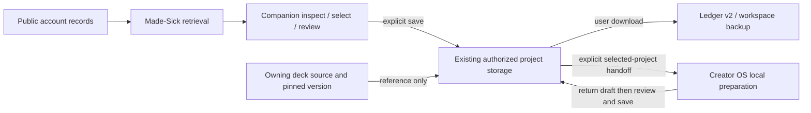

## Canonical runtime amendment — owner direction, 27 October 2026

The existing Railway deployment is PIXIE Companion's one canonical application
runtime: https://pixie-project-companion-production.up.railway.app/.
The old ChatGPT Site is a migration source pending acceptance and explicit
retirement approval, not a permanent second Companion. ChatGPT connects as a
client with separate permissions. Guide/Creator navigation is prepared for this
coordinated cutover; auth metadata and original adapters are intentionally retained
until their dependencies are resolved. See the existing
[cutover inventory and gates](deployment/RAILWAY.md#one-canonical-companion--coordinated-cutover-owner-direction-27-october-2026).
No production data transfer, client update or Site retirement is executed here.
Dated statements below about the Site being live are historical transition status,
not a decision to maintain multiple writable application instances.

# PIXIE Project Companion — independent source review

This is the recovered Companion application module inside the existing PIXIE
guide repository. It is executable source, not a replacement guide or a released
hosting migration. The guide's root application, build and Pages workflow remain
separate and unchanged. Existing ChatGPT Site/App/plugin identities remain live.

## Source and ownership

Owner direction on 26 October 2026 selected this repository, subject to preserving
the guide, as the preferred existing GitHub home. This review module was recovered
from local reconciled source `ee595556dfd352fdcb6342ea5de20b6688f79ff8`.
That history retains Sites v17 `73ef3b57` and Tangled's `2214950e` / `90287b0d`.
`source-recovery.json` distinguishes preserved, adapted and new files by hash.
No private Site bindings, credentials, caches, unrelated starter components or
private participant records were imported. The original checkouts and archives
are retained. No new license or rights transfer is implied by source availability.

The task contract and independent Node runner are new implementation. Shared
project/resource operations, contributor checkpoints, identity UI, styles and
mirror safeguards are recovered and extended, rather than recreated. Retained
`app/api/companion` and `app/mcp` files document the original Sites adapters;
`server.mjs` supplies the independent HTTP adapters. Neither trusts the other's
authentication mechanism implicitly.

## Build and run outside Sites

Requires Node >=22.19.0 and the pinned pnpm version in package.json.

```sh
cd apps/companion
pnpm install --frozen-lockfile
pnpm test
pnpm run typecheck
pnpm run build
pnpm start
```

The runner defaults to `127.0.0.1:4173`. `HOST` and `PORT` select an explicitly
approved deployment's bind address; changing them does not provision or deploy a
service. The existing Vite build writes `tangled-site/`, ignored generated output.
The guide's root build does not copy or publish this module.

Frozen installation succeeded using the verified local pnpm cache after restoring
`pnpm-workspace.yaml`, which was omitted from recovery. Locked package versions
and the supply-chain policy were preserved. This is not evidence of a fresh
network installation on another machine.

## Persistent creator workspace

My projects supports creating, selecting, editing, archiving and restoring projects;
purpose, outcome, state and next action; tasks with progress, blockers and completion
evidence; creator notes; sources with separately labelled supplied excerpts and
retrieval results; and editable, downloadable handoffs. Backup import validates the
whole file before saving and never overwrites existing project IDs. Conflicts can
be imported explicitly as distinct copies. Export before changing hosting origins.
Unsaved edits are excluded from exports and warned about when switching projects.

The independent runner saves each verified DID's workspace in a server-derived
hashed file under `users/` beside `PIXIE_DATA_FILE`. The original workspace file is
legacy unowned data and remains unchanged. Atomic writes, private permissions and
exclusive per-file locks protect both project and encrypted identity storage.
Production browser access uses the existing server-verified Atmosphere session;
no browser key is required. Admin metadata does not grant other users' records.
The machine bearer works only on MCP and grants no unscoped workspace access.
Loopback development retains the existing explicit local-owner mode. Back up the
private volume and user exports; Git is not a data backup.

A static-only web preview instead uses that browser/origin's IndexedDB, explicitly
labelled in the interface. It survives reloads and normal browser restarts but not
browser-data deletion. It does not share data with the independent MCP, other
origins or other devices. Private browsing can discard it. No synchronization is
active. Exports contain project content, not connection keys.

Conversation is enabled only when the independent server has all three private
settings: `PIXIE_MODEL_URL` (HTTPS OpenAI-compatible chat-completions endpoint),
`PIXIE_MODEL_API_KEY`, and `PIXIE_MODEL_NAME`. The user explicitly consents before
sending selected-project context. Bounded recent notes, excerpts, tasks and messages
are sent to that provider; other projects and credentials are excluded. Answers
are labelled AI suggestions, execute no actions, and do not become verified facts.
No provider is configured in this checkpoint: the interface reports unavailable
and saves no fabricated reply. Live provider acceptance remains outstanding.
Public-source checks currently support public GitHub text files; unsupported or
failed checks remain visible as failures beside the retained supplied source.

## HTTP and MCP boundaries

- `/`: independent browser workspace. Find help, Project work and Task stewardship
  share the existing service functions. Browser-static mode executes validated
  read/draft operations locally; external public-source reads still require
  provider availability and CORS. No private database or automatic posting.
- `POST /api/companion`: same supported read/draft operations, same-origin browser
  checks, bounded request body and no server task persistence.
- `POST /mcp`: shared `handleRpc`/`runTool` operations with independent bearer
  authentication. Configure `PIXIE_MCP_TOKEN` privately with at least 32 characters;
  never commit or embed it in browser code. Without it MCP fails closed with 503;
  invalid credentials return 401. Fake Sites identity headers do not authorize it.
- `/health`: reports runner mode and whether MCP authentication is configured;
  never reveals a credential. A health response is not release acceptance.

This minimal bearer adapter is a tested transport boundary, not a completed
multi-user OAuth installation flow. Real ChatGPT/other-client connection and
per-client authorization/revocation require review before public service release.
Do not expose an unconfigured endpoint or treat web identity sign-in as MCP auth.
Atmosphere identity uses the existing AT Protocol provider, account panel and
exact reviewed HTTPS origins in `lib/identity-origin.mjs`. The original Site
keeps the browser SDK and its unchanged
`/oauth-client-metadata.json` and root redirect. The Railway origin
`https://pixie-project-companion-production.up.railway.app` uses the public
`/oauth-client-metadata-railway.json` and its own root redirect. Other origins
cannot start OAuth here and retain the link to the original Site. No Host header,
query parameter or imported record selects a redirect. These are independent
origin-bound sessions, not synchronized accounts. Railway's root callback is now
verified by the official server SDK, pinned at `@atproto/oauth-client-node@0.5.10`.
Client ID, metadata, redirect and atproto-only scope remain unchanged. No provider
or domain is added. Browser JavaScript cannot assert ownership or supply an issuer,
redirect, DID or bearer credential to authorize private workspace operations.

### Atmosphere identity and isolated project storage

The published Railway Companion must support **one Atmosphere sign-in per person**.
Any supported AT Protocol identity can authenticate. The server verifies the OAuth
session and the returned DID before authorizing browser operations. Each verified
DID resolves to a distinct server-owned hashed filename under the existing private
volume's `users/` directory. No handle, path, user ID or ownership claim supplied
in an API request may select another person's workspace. Each user's project list,
selected project, edits, exports, imports, deletion and model context are isolated.

`PIXIE_SESSION_SECRET` is a separate 32-byte random hex encryption key (64
lowercase hex characters), stored **only** in Railway's private variables, never
in browser code, screenshots, issues or shared backups. `PIXIE_OWNER_DID` is
optional administrative metadata; it is **not** an admission list or a grant to
other people's projects. A configured admin still sees only their own workspace.
`PIXIE_MCP_TOKEN` is exclusively for machine MCP authentication and does not
implicitly authorize any user's private project data. Unscoped machine requests
for workspace operations are denied until a separately reviewed principal/grant
model exists. Preserve the existing Site OAuth configuration.

The server uses the existing AT Protocol Node OAuth SDK, encrypted state storage,
opaque Secure/HttpOnly/SameSite=Lax cookies, explicit Host/Origin and CSRF checks,
and server-verified, short-lived sessions. Sign-out and session expiry deny access
without deleting saved projects or other people's sessions. There is **no** second
browser key, no new database/service, and no automatic migration.

The existing `PIXIE_DATA_FILE` (for example `/data/workspace.json`) is legacy,
**unowned** project data. Keep it untouched and unassigned until ownership is
confirmed and a separately reviewed migration/export is approved. Never treat the
first DID to sign in as its owner. Keep the persistent volume, encrypted identity
state, backups and one-writer restriction intact. Railway failure must not cause
fallback to an anonymous browser workspace masquerading as server data.

Verification includes two independent synthetic accounts and full sign-in →
create → save → reopen → sign-out flows; cross-user read/write/export/import/erase
and machine access must fail. These tests do not replace live provider, iPad Safari,
VoiceOver, session-restoration, persistence or restart acceptance. Do not merge,
deploy, change the domain or retire the original Site without a separate release
review and authorization.

## Supported operations: read versus draft versus execution

| Operations | Behavior |
| --- | --- |
| list_projects, get_project_status, discover_resources, get_resource, resume_checkpoint | Read curated/public sources; retain dates and retrieval limitations. |
| suggest_contribution, prepare_feedback, prepare_checkpoint, prepare_enquiry | Prepare proposals/drafts. GitHub submission and professional contact remain user actions. |
| export_project_handoff, prepare_followup, resume_followup | Prepare/validate explicit portable context. No automatic synchronization or server storage. |
| prepare_task_contract, update_task_contract, resume_task_contract | Maintain explicit task context; scope fields stay fixed during updates. Imported context requires fresh review. |
| check_task_action | Reports in-scope/out-of-scope/approval requirement. Executes nothing and grants no credentials. |

No supported operation publishes, deploys, merges, sends correspondence, spends,
grants repository access or approves canon. Explicit confirmed workspace deletion
affects only saved creator records; it does not delete repositories or sources. A scope check cannot constrain
unrelated tools in a host, and an editable file is not cryptographic authorization.
The companion's own task updates cannot silently change outcome, project, actions,
constraints or completion criteria. A new scope requires a new explicitly reviewed
task. Reported completion requires evidence but is not verified completion.

## Portable continuity and privacy

Task stewardship records outcome, supported actions, constraints, completion
criteria, status, progress, next action and evidence. Download/import preserves
task ID and revision. Edits must update the working contract before export, and
every import/update resets the public-safe review gate. Changing the selected
project does not silently discard or reassign the working task.

For public task stewardship, only export public-safe material. Its working text
remains in tab memory; downloaded files belong to the user. The separate My projects
workspace persists as described above; inspect private content before sharing exports. Existing Remember/Forget retains only a public GitHub
issue pointer on that device. GitHub issues remain the shared contribution record.
No opaque chat memory, cross-domain draft transfer or synchronization is claimed.
MCP clients/hosting providers have their own retention. Do not enter credentials,
private briefs, health/benefits records or confidential correspondence.

## Tests and accessibility

`pnpm test` covers existing project/resource/checkpoint behavior, task round-trips,
scope rejection, forged imports, completion evidence, independent HTTP/MCP parity,
fail-closed authentication and the existing mirror safety fixtures.

`pnpm run check:browser` uses a separately available Playwright/Chromium runner;
set `PIXIE_PLAYWRIGHT_MODULE` to its module path, `PIXIE_CHROMIUM` to the browser
executable, and `PIXIE_BASE_URL` to the local runner. It does not deploy or submit
anything. Evidence defaults to ignored `review-evidence/`. Browser tooling is not
an application runtime dependency.

Physical iPad Safari/Files, VoiceOver, a desktop screen reader, clean install,
independent live-source checks and a separate contributor's plugin installation
remain acceptance gates. Never substitute a build, viewport emulation or an
automated contrast check for those observations. Preserve existing identities,
styles, explicit consent and source-first behavior in future changes.

## Existing plugin and Tangled mirror

The installed plugin remains the existing owner-identified 1.0.4 release; the
local historical public-submission manifest says 1.0.3 and is not a verified new
release. Installed tools still expose the previous catalog; these new task tools
are source candidates, not installed changes. Plugin search did not return an
editable PIXIE release ID. No replacement plugin or guessed release was created.

The existing public Tangled mirror was read without mutation at
`https://tangled.org/made-sick.org/pixie-project-companion`: main advertised
`90287b0d64475df606667078d9bb98bbfc07651a`, with no tags in that response.
It is NOT synchronized with this new GitHub module. The source roots differ:
this repository contains the guide plus `apps/companion`; the existing mirror
contains the older Companion at its root. Do not push the whole guide repository
through the retained mirror helper, force-update the mirror, activate automation,
or invent a second mirror. Agree and verify a history-preserving module mapping
under separate authorization after source review. Until then report not synced.

## Release and Site-retirement gate

Do not merge/deploy this module, change domains, repoint the existing plugin or
delete the Site merely because local tests pass. First verify clean installation,
independent hosted behavior, live source access, accessibility, auth/client update,
mirror mapping and every Site-bound dependency. Record exact source/build/client
and human acceptance evidence. Source recovery, review publication, deployment,
plugin update and Site retirement are distinct actions.

## Current local verification and mirror review

`pnpm test` includes persistent workspace round-trips, isolated project operations,
validated non-overwriting imports, corrupt-file preservation, unavailable-model
behavior, provider-context isolation, cross-user API denial, and unscoped MCP denial. Run
`node tests/browser-workspace.cjs` after building, with the same Playwright/Chromium
variables described above. It starts its own loopback servers and temporary file
store; it never erases an existing workspace. It checks both server and static
storage, browser restart, handoff edits, export/clear/restore, reading preferences,
keyboard skip navigation and 320–1440 px reflow. Test data is fictional.

The retained whole-root mirror helper now refuses this module layout.
`scripts/prepare-module-mirror.mjs` prepares only a local review bundle from pinned
source and Tangled commits. It projects `apps/companion` to the existing mirror
root and retains both histories as parents. Projected commit IDs differ from
GitHub IDs; exact module tree identity is recorded. Review deletions, ownership,
privacy, hosting/build triggers and rollback before authorizing any application.
There is no push mode and synchronization remains inactive.

The existing Site MCP at
`https://pixie-project-companion.ibloud-ivxx.chatgpt.site/mcp` remains separate and
unchanged. A Vercel static preview serves the web interface only. This independent
MCP has source tests, but hosted deployment and plugin connection remain unfinished.

## Existing Railway service preparation

Service-specific Railpack/start/readiness configuration is in `railway.json`.
The existing guide root build is untouched. Use the fail-closed production launcher
`node scripts/start-production.mjs`, with privately configured machine and identity secrets,
local-owner bypass disabled and a real persistent volume. See
[deployment/RAILWAY.md](deployment/RAILWAY.md) for exact existing-service settings,
non-secret variables, verification evidence, rollback and current access blockers.
The 9e836768 pin below is a historical rollback reference. Use the dated current release in deployment/RAILWAY.md and re-read Railway before any approved release; this review does not release the candidate.
The static Vercel preview continues to use browser storage and hosts no MCP.

## Corrective security review

OAuth uses the official SDK's existing locked Node safety adapter with native
fetch. HTTPS, DNS/private-address and redirect-hop checks stay attached to its
transport. It does not use the unrelated Wrangler proxy dispatcher. Anonymous
session-status reads no longer consume pending-login slots; actual login attempts
retain bounded, cookie-bound CSRF-protected transactions. Session capability
responses identify the verified DID so resumed tabs clear a previous account's
private view before reopening the current workspace.

Private file operations use an exclusive per-file lock shared across Node
processes. Lock contention fails without acknowledging a save. Keep one Railway
replica; this is not distributed storage. A crash may leave a `.lock` file: stop
all writers, back up and validate the data, confirm no writer remains, and remove
only the verified stale lock under separate operational approval. Never break a
lock automatically or discard saved data to recover.

The behavioral suite includes the real SDK transport boundary, synthetic A/B
account isolation, nested-record/import rejection, expired sessions, CSRF,
corrupt-file preservation, independent writers and anonymous login-capacity
protection. `node tests/browser-owner.cjs` additionally checks account switching,
legacy-data preservation, dark/light text contrast and restart recovery. Browser
provider cryptography is synthetic; live OAuth and physical iPad acceptance remain
required. Browser checks currently require separately available tooling and are
not claimed as enforced GitHub checks.

## Creator OS handoff — review only

The selected private project can explicitly open the existing Creator OS at
https://ibloud.github.io/pixie-creator-os/ after a consent prompt. Only project
name/purpose and its last reviewed creative draft leave this tab. Exact origin
and opened-window checks bind the exchange; no bearer, CSRF or OAuth token is
sent. The returned draft is shown for review and saved as a creator note through
the existing workspace API only after confirmation and a fresh verified-DID check.
The granted project ID is fixed; a browser-supplied target cannot replace it.
Creator OS retains media preparation, source-aware references and manual sharing.
No new identity provider, PDS record, database, scope or automatic publication is
introduced. Sequential retries of the identical receipt do not append twice.

Both review candidates are required; current public Creator OS and pinned Railway
production are unchanged. Reopen the same private project after sign-out to resume
the saved draft, reselect media and review publishing again. Unsaved returns are
not persistence. Logout/identity change revokes the handoff; exports already
chosen by a user cannot be remotely revoked. A severed opener or failed connection
must retain the existing file handoff rather than trust arbitrary origins.
GitHub Pages shares ibloud.github.io across repositories; release review must
accept that origin's trust boundary. No public deployment is authorized here.

Local cross-application test: set PIXIE_CREATOR_ROOT to the reviewed existing
Creator OS checkout, then run node tests/browser-creator.cjs with the existing
Playwright/Chromium variables. The upstream provider is synthetic; physical iPad,
live OAuth, private hosting and Railway backup/restart acceptance remain separate.
The existing shared account picker also keeps a submit pointer gesture stable:
closing suggestion results/status on blur must not move Continue before click.
This changes no provider, session, metadata or OAuth permission. Original Site and
static-origin identity regression fixtures remain required.


## Source-check outcome and retrieval boundary

The existing shared `workspace_check_source` operation returns the saved project,
source record, an `ok` boolean and a readable `notice`. The browser displays that
notice; MCP returns the same validated records and marks a failed check
`isError: true` even though its failure record was saved successfully. A fetched
page is not verified fact. Prior excerpt/date, source URL/title, creator notes
and project identity survive a failed retry; `checkState: failed` and `lastError`
distinguish the latest failed attempt. No backup/storage schema changes.

Only the existing fixed public GitHub contents API is contacted, with manual
redirect handling and a ten-second timeout. The response is now limited to
200,000 decoded bytes **while reading**, not after allocating its entire text.
Oversized bodies cancel their reader; rejected declared lengths cancel before
reading. Failed, unsupported and aborted checks retain recoverable work. No
arbitrary URL fetcher, additional provider, public-by-link store or run engine
is added. Long-operation progress/user cancellation and quote matching remain
unimplemented; this correction does not claim them.

Pattern review: [Osiris MCP results](https://github.com/simplifaisoul/osiris/blob/085b2429b11b2b1af43880caaa088575cc98c14f/src/lib/oi/mcp.ts)
separate readable summaries, structured data and tool errors. Its source quote
matching checks text presence, not truth; its process-memory public run store is
unsuitable for PIXIE's private continuity. Its shared service, injected provider
and bounded network patterns informed this review. This correction independently
extends PIXIE's existing code; no Osiris code was copied or dependencies added.
Osiris is MIT-licensed, copyright 2026 simplifaisoul. If code is copied in future,
retain its full copyright and license notice. Existing analytics, IP logging,
surveillance UI and forecasting engine are not adopted.

Verification extends existing workspace and identity test suites with streamed
size/abort/recovery checks, matching HTTP/MCP outcomes on the same service state,
and cross-user/ungranted-machine denial. Browser acceptance must show the saved
failure state and notice without reporting success. The existing helper and
central styles are unaffected. This is source review only; no deployment or
live-provider acceptance is implied.

## Story references, Creator handoff and deck authority — review 9 November 2026

This review extends PR #14 (`ea923bb`) rather than reimplementing Story Finder.
The existing implementation gap was the absence of search/selection in My projects.
The canonical ecosystem map remains
[ECOSYSTEM_ARCHITECTURE.md](https://github.com/ibloud/ibloud.github.io/blob/main/docs/ECOSYSTEM_ARCHITECTURE.md).
Its dated source-identification hold predates the later recovered module and
27 October runtime amendment above; no source migration is performed here.

| Responsibility | Existing authority / implementation | Boundary |
| --- | --- | --- |
| Private project creation and persistence | This module: `app/creator-workspace.tsx`, `lib/workspace.mjs`, `lib/workspace-browser.mjs`, `lib/workspace-store.mjs`, `server.mjs` | Existing server-verified DID workspace; static previews use explicitly labelled origin-local IndexedDB. No parallel database. |
| Public story retrieval and Ledger v2 | Made-Sick PR #72; byte-identical pinned `public/shared/story-retrieval.js` and `story-ledger.js`, provenance in `story-source.json` | Read-only public evidence; no private records or automatic canon acceptance. |
| MCP story tools | `lib/companion.mjs`, `lib/story-discovery.mjs`, PR #14 | Existing authenticated transport; website identity is not plugin authorization. PR #12 remains separate and disabled. |
| Project reference review | `app/story-references.tsx`, existing My projects create/edit flow | Explicit selected-text/destination review before transactional save. |
| Creative preparation | `ibloud/pixie-creator-os`: `creator-model.js`, `creator.js`, `creator-environment.js` | Local-first media context, credits and accessibility text; reviewed return, not synchronization. |
| Deck definitions and rules | Each deck's owning source; see inventory below | Companion stores references and annotations, never takes over rules/canon. |



Implemented on the review branch: optional account/query/provider/page-bounded
search in project creation and existing-project Sources and evidence. Continuation
keeps prior matches; cancellation, coverage and errors are visible. Reposts and
other authors' contextual posts remain inspectable but cannot be relabelled as
account-authored attachments. Replies retain their reply flag; surrounding thread
text is not silently included. Original text is rendered as text, never HTML.
Up to 25 selected original records can be reviewed per attachment. A save failure
reports no success. Creation plus references is one existing storage transaction.

`workspace_attach_stories` and optional creation fields `story_result_json` /
`stories_reviewed` use the same project authorization and storage transaction.
Each source may contain an additive `storyReference: {result, ledger}`:
`result` contains the reviewed actor and one original match, including retrieval
endpoint/time/source and identity-verification caveat; `ledger` is unchanged
Made-Sick Ledger v2 with URI, CID, author DID, source/selection times and original
text. Old backups without this field remain valid. Current exports/imports retain
it exactly. Earlier application versions reject unknown fields rather than safely
round-trip new backups; use this version for restoring backups with references.
A URI/CID already present is deduplicated; a changed CID at the same URI is
rejected for separate review. Import provenance remains untrusted, not reverified.
Existing workspace size/count limits still apply. No database migration is added.

### Existing Creator OS handoff contract

Reviewed current Creator source at `9358a26f97f6012e3107dd61ae96075ea1889569`.
Companion's `lib/creator-handoff.mjs` already binds an opened Creator tab, exact
origin, initiating DID and project. Sender and receiver recheck the originating
session before saving. The user reviews the return in Companion; a successful
`workspace_add_note` response precedes the saved acknowledgement.

| Contract item | Existing behavior / precise limitation |
| --- | --- |
| Outbound | Explicitly send selected project ID, name, purpose, initiating DID, and last saved Creator draft. Other notes/projects and credentials excluded. |
| Return | `pixie-creator-return/v1`, receipt ID, JSON `pixie-artist-draft/v1`; 9,000-character limit. Draft carries title/link/caption/credits/description, rights statement, destination, recorded links and bounded environment references. |
| Authority | Creator validates its draft; Companion validates the receipt envelope and draft schema marker. Receipt data remains untrusted creator context, not accepted canon, proof of rights or instructions. Companion does not claim full Creator-model validation. |
| Destination | Existing initiating project only. Create/select it in Companion first. No automatic new-project creation or destination inferred from imported data. |
| Duplicates/conflicts | Identical receipt is deduplicated; changed receipts append notes. No silent overwrite or merge. Receipt ID and draft `pixie_id` are not card/source IDs. |
| Exclusions | Media bytes, local file paths, credentials, automatic uploads/publication, account linking and automatic synchronization. |
| Recovery | Failed save receives no acknowledgement. Retain/download draft and retry after restoring the initiating account/project. Oversized/disconnected work uses existing manual download/import. |
| Research references | Creator's separate Story Router imports Ledger v2 through `story-ledger.js`; the artist-draft return does not carry arbitrary Story Router selections. Companion's reviewed Ledger v2 references remain separate. No automatic bridge is claimed. |

No extension to Creator OS was necessary to expose the existing bounded handoff.
Existing Companion handoff tests cover origin/source/session binding and save
review; cross-origin live compatible-release, iPad and VoiceOver acceptance remain
unverified. A new Story Router-to-artist-draft bridge requires an explicit contract
extension preserving Ledger IDs and review, rather than copying a second project
store.

### Card data and cross-brand export contract — proposal, no storage change

Current source inventory: Veiled Dominion engine main
`b190754456549e313f1971f92fde3f35c296a97d` owns its canonical rules and contract
versioning. Paragon-Reborn main `3ddb52994be4450c11c54ec07d2288372587a375`
owns `docs/ORIGINAL_HERO_CARD_DIRECTION.md` and the existing v1 rules schema and
`first-slice-v1.json` fixture (`tarot-strength`). Its new original hero-card
mechanics remain proposals, separate from historical tarot material and Veiled
Dominion canon. The direction explicitly requires stable IDs independent of
printed numbers, and defers playing-card/tarot mappings. No universal production
card catalog, ownership registry or card-order API has been verified in these
reviewed sources. This inventory does not establish every ecosystem deck's owner;
additional decks must supply their own authoritative source before integration.

Use project-owned definitions and a shared portable contract. Physical database
hosting is a later implementation choice; a single host must still enforce these
logical ownership boundaries. Cross-branding creates a versioned presentation
variant pointing at an approved card revision, never rewrites the source deck.

| Record | Owner / source of truth | Access and mutation | Version and export/import rule |
| --- | --- | --- | --- |
| Deck/card definition | Owning deck repository or its explicitly designated service | Read under its actual license; only its maintainer-approved process changes definitions | Namespaced deck/card IDs plus immutable source commit/content revision. Export approved definition or source reference according to rights; reject unsupported versions. |
| Rules / narrative canon / provenance | Relevant project rules and canon authority | Reviewed project changes; AI proposals and user annotations do not amend canon | Pin rules/content versions and source evidence. Keep original text and attribution distinct from adaptations. |
| User collection / ownership claim | User record, with issuer evidence where available | Private to user; user edits their claims; only a trusted issuer verifies entitlement | A claim or card image grants no IP ownership. Export only user-authorized data; retain verification status. |
| Project selections / annotations | Authorized Companion project | Project owner via existing project storage; no write to deck origin | Reference exact deck/card revision. Preserve annotations separately; duplicates by namespaced ID/version, explicit conflicts. |
| Draft changes / brand variant | Creator's local draft or explicitly selected project | Creator edits proposal; deck owner accepts canonical changes | Separate draft/variant ID and revision, source card reference, brand assets and rights metadata. Import as draft, never replace canon. |
| Gameplay/session state | Owning game runtime | Runtime validates moves and state; Companion/print tools cannot mutate it | Pin rules/content version, selected IDs and replay/choice events. Separate from collection and artwork exports. |
| Print/render package | User-reviewed export snapshot | Exporter reads approved content and brand variant; manufacturer receives only explicitly submitted files | Schema version, deck/card IDs/revisions, ordered front/back mapping, template/brand revision, checksums, attribution/rights and vendor-specific print profile. Import validates schema, identities and conflicts; no write-through. |

Proposed package fields: `schemaVersion`, `packageId`, `ownerProject`, `deckId`,
`deckRevision`, `rulesRevision`, `cards[{cardId,cardRevision,sourceRef,front,back}]`,
`brandVariant{id,revision,sourceDeckRef}`, `templateRevision`, `printProfile`,
`provenance`, `rights`, `assetChecksums`. Names are proposed, not an implemented
schema or an assertion of rights. Missing authority, rights, source revision or
asset files must produce an actionable validation failure, never a guessed value.

Use JSON for identity/provenance and a CSV projection for renderer variables;
package rendered assets and a manifest with deterministic ordering. Polotno and
QPMN are candidate rendering/fulfillment adapters from the user's references;
current account access, endpoints and printer specifications have not been
independently verified here. Rendering and ordering are separate steps. A digital
Deck of Cards API does not establish print fulfillment or authority over authored
decks. No ordering integration, purchase or API credential collection is added.

For onboarding, offer one useful starter task with click/keyboard alternatives to
dragging, optional short motion and reduced-motion support. Keep a clear Skip to
workspace and a reopenable help deck. Checklist completion must not gate workspace
access. Task cards are UI objects, not canonical game-card definitions. This is a
UX recommendation; no onboarding redesign was bundled into the reference workflow.

### Verification and release boundary for this increment

Companion unit/integration/security suite: 89 tests pass; TypeScript and Vite
production build pass. Existing guide syntax/content checks and static build pass.
`tests/browser-story-references.cjs` exercises create and existing-project review,
save/reload, deduplication, original-text rendering and Ledger download in Chromium
with fixture providers, plus 320/390/820px reflow at 24px text. The existing
`tests/browser-workspace.cjs` covers server and origin-local browser storage,
restart, backup/restore and normal project/task/source regression behavior.
Creator handoff's three existing unit tests pass. Provider pagination, cancellation,
429, empty and unavailable cases are covered through the pinned retrieval module.

Commands: `pnpm test`, `pnpm run typecheck`, `pnpm run build` in this module;
`node tests/check.mjs` and `node scripts/build.mjs` in the guide root. Browser
runners use `PIXIE_PLAYWRIGHT_MODULE` to point at the external test harness;
no production dependency was added. Source checksums remain pinned and tested.

These results do not verify live providers in the new UI, physical iPad Safari /
VoiceOver, deployed backend, installed ChatGPT plugin, or cross-origin Creator
live acceptance. PR #14's published historical local-HTTP/direct-PDS evidence is
prior evidence, not a new production claim. Its existing preview predates this
increment. PR #12 remains open and disabled; security/release gates are untouched.
No merge, Railway release, storage migration, auth/DNS change, installed-plugin
update, purchase or old-runtime retirement is authorized by these tests.

## Standard.site references and explicit project imports — review 9 November 2026

This increment follows PR #15 (`2779d5b`) and PR #14 rather than replacing either.
Both and Made-Sick PR #72 were open at inspection; guide main was `2ea7361`.
Creator main was `9358a26`. Current source, AGENTS.md, release gates, relevant
schemas and PR records were inspected. Made-Sick already owns Standard.site
lookup in `published-work.js` and its Sifa/published-work documentation. The exact
unmet need was project-governed review/import in Companion, not another reader,
directory, project database or publication service. The canonical ecosystem
architecture remains the linked governance source above.

Made-Sick's `review/standard-reference-contract` extends its reusable readers with
`standard-references.js`; Companion uses byte-identical copies, pinned separately
in `public/shared/standard-source.json`. Creator's matching context validator is
pinned there to its own owning source. Existing Bluesky Ledger v2 and its pins are
unchanged. `pixie.standard-reference/v1` and `pixie.standard-import/v1` are explicit
new snapshot contracts, not an implicit Ledger schema expansion.

### Project import definition and save contract

Projects without `importDefinition` remain valid. They show an explanatory state;
reference attachment still works independently, while metadata/content import
fails closed. Only the authorized owner explicitly configuring supported imports
creates `pixie.project-import/v1`; no project title, remote record or AI suggestion
selects a permissive default. The UI presents these fields before confirmation:

| Field | Supported values / application ceiling |
| --- | --- |
| `schema` | `pixie.project-import/v1` |
| `collections` | Explicit subset of `site.standard.document`, `site.standard.publication` |
| `operations` | Explicit subset of reference, metadata, content; configuration UI offers metadata/content while standalone reference attachment remains independent |
| `formats` | `text/plain` only |
| `maxItems` | 1–25 imported snapshots per project (standalone reference attachments excluded) |
| `maxTextLength` | 1–20,000 characters; the existing workspace's 2MB/record limits also apply |
| `destination`, `contentDestination` | Existing `sources`, separate `imported-drafts` |
| Provenance, rights, review | Required provenance, explicit review, permission declaration when copying content; no independently verified rights claim |
| `conflictPolicy` | `reject-revisions`: no silent overwrite or refresh |
| `creatorDestination` | Explicit boolean; unchecked by default, plus separate exact-payload review required for any handoff |

`workspace_configure_imports` validates and saves the definition through the
existing authorized workspace transaction. `workspace_import_standard` validates
the selected snapshot and operation, then atomically saves provenance separately
from a new local draft. `workspace_edit_imported_draft` edits that draft alone.
New fields are additive; no storage migration runs. Backups round-trip provenance,
recorded definition, permission declaration and local edits. Earlier application
versions may reject these new fields; restore such backups using this version.

Reference attachment copies stable identity, title, attribution, revision, dates,
publication relationship and retrieval/verification evidence; description/body
are excluded. Metadata additionally copies the description. Supported content
copies the exact plain-text representation into a separate local draft and keeps
the immutable source snapshot free of body text. Every confirmation names the
project, destination, copied/excluded fields and relevant definition. None becomes
accepted canon, a canonical card definition, executable instructions or verified
ownership. Local notes and canonical source records remain distinct.

Same URI/CID/operation imports deduplicate. A later changed CID is rejected even
if local edits exist; nothing is overwritten. A different operation on the same
revision can create its own explicit snapshot. New definitions govern future
imports and Creator transfers; historical snapshots retain their original
reviewed definition. Source disappearance or publication failure is reported;
there is no inferred replacement, background refresh or remote deletion
propagation. PDS deletion does not establish deletion from pckt or other copies.

### Supported retrieval and precise limits

The shared reader uses existing verified handle/DID/current-PDS handling, closed
provider restrictions, no credentials, manual redirects, request timeout and
bounded decoded responses. It supports an account/collection page (up to 20
records, explicit continuation and cancellation) or one exact Standard.site AT-URI.
A URL alone is a link, not record identity; no arbitrary URL importer is added.
Repeated cursors, identity mismatch, malformed provenance, errors and rate limits
remain visible. Requests do not use publishing scopes or private-workspace data.

Snapshots retain author DID/handle, collection/rkey/AT-URI, CID, publication
relationship and resolved publication CID, canonical URL, source publish/update
dates, retrieval timestamp/endpoint, content type/representation and verification
limitations. CID and account records are source-reported; no signature verification
is claimed. A missing publication or document-specific path yields no invented
canonical URL; save asks the user to retry after resolving that source.

Standard.site's current lexicon leaves rich bodies open-ended. Public pckt sample
records contain `blog.pckt.content` (`items`) and separate `textContent`. Only that
schema-defined plain-text field is copied. Rich bodies, HTML, blobs, media and
undocumented REST/oEmbed APIs are not converted or fetched. Missing or over-limit
plain text remains reference-only with an explanation. Application ceilings may
be stricter than lexicon maxima.

Website-to-record checks are separate, explicit and bounded. The publication
`.well-known` endpoint and browser-parsed document head link are compared to the
exact AT-URI. Only reviewed pckt.blog hosts are fetched. Custom domains,
unsupported providers, CORS/network errors, unavailable parsers, redirects and
mismatches do not become verification success. A match confirms reciprocal web
association only, not authorship, rights, ownership or cryptographic verification.

Primary documentation checked: [document schema](https://standard.site/docs/lexicons/document/),
[publication schema](https://standard.site/docs/lexicons/publication/),
[reciprocal verification](https://standard.site/docs/verification/),
[AT Protocol XRPC](https://atproto.com/specs/xrpc), and [pckt](https://pckt.blog/).
Exact linked schema CIDs and the live pckt representation evidence are recorded
in Made-Sick's existing `docs/story-finder-retrieval.md` review addition.

### Creator and publishing boundaries

Artist-draft v1 cannot represent imported Standard.site source identities. The
small extension is `pixie.standard-creator-context/v1`, carried in the existing
origin-bound handoff's v2 message/receipt. The source contract, exact fields,
limits, tests and backward compatibility are documented in Creator's existing
`docs/artist-workflow.md`; both applications use the same strict validator.

The project must explicitly permit the Creator destination and relevant
collection/content. The user selects one saved source and reviews the exact
payload. Companion rechecks current private project data and permission before
sending; an older Creator that does not advertise support receives no project
payload when this extension is requested. With no imported context selected,
v1 behavior remains unchanged. Context appears read-only in My PIXIE, in memory;
it is not silently merged into captions or restored from an older receipt.

Explicit return retains source ID/CID/attribution beside the artist draft.
Companion rechecks the initiating DID/project, current definition and unchanged
approved payload before the existing reviewed private-note save. Failed/oversized
returns receive no false acknowledgement. Sign-out/disconnect clears the Creator
context. Media bytes, credentials, other imports and automatic synchronization
are excluded. Compatible source in review is not proof that both live origins
are deployed or accepted.

After independently publishing through the chosen service, the user can record
its public URL using the existing Sources and evidence form, labelled as a
user-reported external publication. That record is not proof of publishing or
delivery. Existing Creator sharing/link-receipt controls remain manual. No new
publisher, AT Protocol writes, account linking, OAuth scope, credential form or
change to PR #12 is introduced. Deck ownership/export contracts remain separate.

### Validation and acceptance ledger

- Companion unit/integration/security tests, typecheck and production build;
  existing guide checks/build. New negative tests cover missing/disallowed policy,
  rights/review, malformed/unsafe snapshots, cross-workspace IDs and unauthenticated
  or unscoped-machine import access. Shared-source checksums remain enforced.
- `tests/browser-standard-imports.cjs`: fixture account discovery → source/link
  preview → explicit definition → review → reference/content import → local edit
  → save/reopen/export, revision conflicts and inert source markup in server and
  browser-local stores; 320/390/820px at 24px text and keyboard controls.
- Creator's `tests/browser-standard-handoff.cjs`: two real local application
  surfaces, synthetic upstream identity and source fixtures, capability negotiation,
  reviewed v2 return, authorized private save and logout clearing. Creator's
  existing unit/browser suite remains required; v1 handoff regressions remain.
- Live, read-only provider evidence: exact public document
  `at://did:plc:o6kuv3yieti2vqrb7ckmd5vg/site.standard.document/3mzkofw7ak7xb`
  resolved with source-reported CID, publication URL and 3,056-character plain
  text. A separate page returned 14 records plus continuation. No private import,
  installed MCP invocation or live publishing was performed in that check.

Fixture/browser checks do not establish live pckt reciprocal verification, browser
CORS across all providers, deployed backend, installed plugin, physical Safari /
VoiceOver or compatible live Creator releases. No merge, production release,
plugin activation, storage migration, DNS/authentication change, purchase or
retirement is performed. All existing backup, independent security and release
gates remain in force. Source commits, checks and automatic preview links belong
to the focused review PRs, not to a production-acceptance claim.

## PIXIE assistant producer — use-case record

The owner-confirmed [assistant-producer use case](review/ASSISTANT_PRODUCER_USE_CASE.md)
describes PIXIE guiding the owner in GarageBand on iPad/iPhone while their producer
uses Logic on a Mac. It records reusable implementation, missing capabilities,
acceptance criteria and Creator OS ownership links. It is product direction and
a review record, not a claim of vocal analysis, DAW control or a released workflow.
